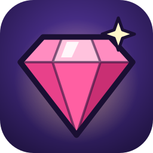
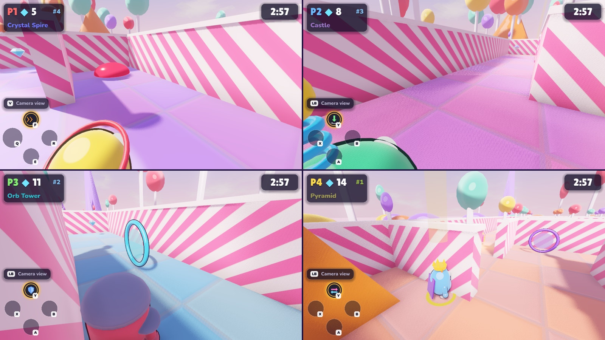
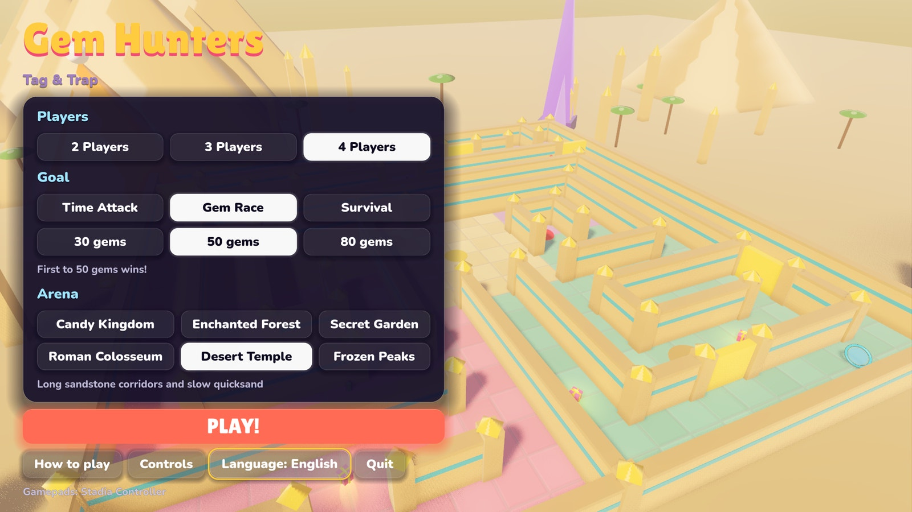
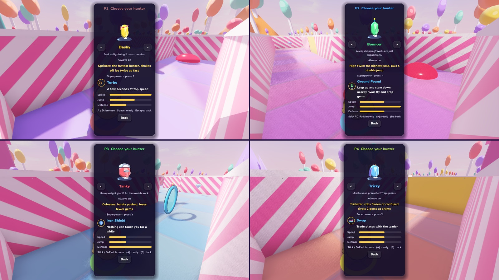
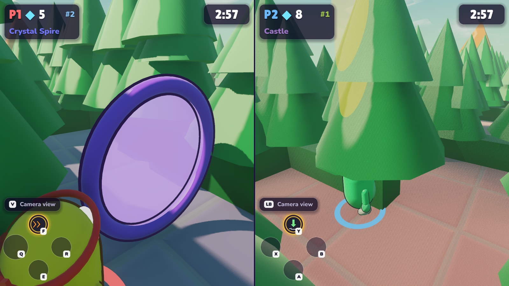
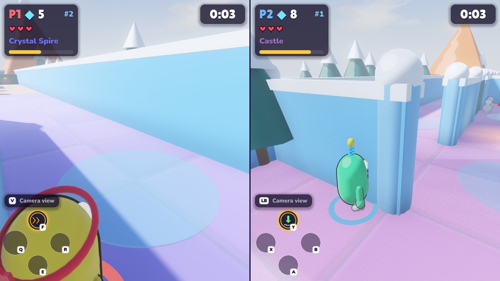

<div align="center">



# Gem Hunters: Tag & Trap

**A couch party game for 1–4 players: grab gems, set traps, steal from your friends.**

Split-screen 3D chaos in freshly generated mazes, made with Godot 4 by **Wennovate**.

[](https://godotengine.org/)
[](LICENSE)


[**⬇ Download**](../../releases/latest) · [How to play](#how-to-play) · [Controls](#controls) · [Run from source](#run-from-source) · [Contributing](CONTRIBUTING.md)



</div>

## Why you'll love it

- 🎮 **1–4 players on one screen.** One on keyboard and mouse, everyone else on a gamepad. No accounts, no internet.
- 🌍 **A new maze every match.** Six themed worlds, each with its own twist: candy trampolines, forest portals, garden sprinklers, Roman moving gates, desert quicksand and slippery winter ice.
- 🎁 **15 items in gift boxes.** Cake traps, water balloons, banana peels, spring gloves, snowballs, thunder, warps, radar... and boxes that are just pranks.
- 🦸 **8 hunters, 4 superpowers.** Each hunter has an always-on trait plus one superpower: Turbo, Ground Pound, Iron Shield or Swap with the leader.
- 🤖 **Computer rivals.** Bots fill the empty seats, so you can play alone too.
- 🏆 **4 ways to win.** *Time Attack*, *Gem Race*, *Survival* or *Collector*, with a double-gems **frenzy** for the final stretch.
- 👨‍👩‍👧 **Made for kids 9+.** Bright, readable and silly. Hitting a rival makes them drop gems, never hurts anyone.

<table>
  <tr>
    <td></td>
    <td></td>
  </tr>
  <tr>
    <td></td>
    <td></td>
  </tr>
</table>

## Download

Grab the latest build from [**Releases**](../../releases/latest): an installer or a portable build that runs without installing.

| Platform | Installer | Portable |
|---|---|---|
| Windows x86_64 | `GemHunters-windows-x86_64-setup.exe`: Start menu entry and uninstaller, no admin rights needed | `GemHunters-windows-x86_64-portable.zip`: unzip, then run `GemHunters.exe` |
| Linux x86_64 | `GemHunters-linux-x86_64.deb`: `sudo apt install ./GemHunters-linux-x86_64.deb`, then find it in your app menu or run `gem-hunters` | `GemHunters-linux-x86_64-portable.tar.gz`: extract, then run `./GemHunters.x86_64` |

## How to play

- **Grab gems.** They're worth 1, 3 or 5. The golden gem in the center plaza is worth 10, and the once-per-match **Chaos Gem** halves every rival's gems.
- **Jump on heads.** Landing on a rival steals their gems. Just bumping into each other wins nothing: you both bounce apart and drop 3 gems.
- **Open gift boxes.** You get up to 3 item slots. Traps catch their owner too, and some boxes are pranks.
- **Watch the crown.** The leader wears a crown and a golden light beam that everyone can see over the walls.
- **Know your zone.** Every arena has four colored zones with giant landmarks around a Golden Plaza, and each screen names its zone, so a peek at a rival's screen tells you where they are.

| Mode | How to win |
|---|---|
| **Time Attack** | Most gems when the clock runs out |
| **Gem Race** | First to the target (30, 50 or 80 gems) |
| **Survival** | Everyone starts with 3 lives and every hit costs one. Every 10 gems buy a life (5 at most). Last hunter standing wins |
| **Collector** | Collect one gem of each of the 5 colours, then grab the golden gem in the plaza. If a rival grabs it first, every collection is emptied |

The in-game **How to play** screen covers everything, with pictures.

## Controls

Player 1 plays with keyboard and mouse. Players 2–4 each need a gamepad.

On a phone or tablet (in the browser) Player 1 plays with touch controls: a stick under the left thumb to move, a second one under the right thumb to look around, and buttons for jump, items and the superpower.

| Action | Keyboard + mouse | Gamepad |
|---|---|---|
| Move | W A S D | Left stick |
| Look | Mouse (or I J K L) | Right stick |
| Jump | Space / right click | RB / RT |
| Items 1–3 | Q E R (or wheel + left click) | X A B |
| Superpower | F (or wheel + left click) | Y |
| Camera view | V | LB |
| Pause | Esc | Start |

- Gamepads go to P2, P3 and P4 in the order you connect them. P1 gets a pad only when everyone else already has one.
- The menus work with a pad too (A to confirm, B to go back).
- **Controls** in the main menu remaps every button, with a separate layout for each gamepad model.
- Settings are saved to `~/.local/share/gem-hunters/` on Linux and `%APPDATA%\gem-hunters` on Windows.

## Run from source

1. Install **Godot 4.7 stable** (the standard build, not .NET) from the [Godot archive](https://godotengine.org/download/archive/4.7.2-stable/).
2. Clone this repository and launch:

```bash
git clone <this-repo-url> gem-hunters
cd gem-hunters
./start.sh                                   # first run imports assets, then starts the game
./start.sh --windowed --resolution 1600x900  # extra arguments go to Godot
```

`start.sh` finds Godot in `.tools/Godot_v4.7.2-stable_linux.x86_64`, then in `$GODOT_BIN`, then as `godot4` or `godot` on your `PATH`. On Windows or macOS, open `project.godot` in the Godot editor and press **F5**.

CI (`.github/workflows/release.yml`) runs on pushes to master. When master gets a version (`config/version` in `project.godot`) that has no release yet, CI tags the commit `v<version>` and publishes the release with the installers and portable packages. To ship a new version, bump that number. Any branch can be built by hand from the Actions tab.

## Project layout

```
autoloads/       global singletons: Constants, GameManager (match state, scores, lives), InputManager, ...
scenes/main/     Main.tscn + SplitScreenManager, which assembles a match
scenes/level/    procedural arenas: MazeGrid (data) → MazeLevel (walls/floor) → MazeScenery + MazeProps
scenes/player/   Player body + Look / Status / Items / Combat components, shared CharacterModel
scenes/ui/       menus, HUD and its components, character selection, How to play, Controls
scenes/powerups/ gift boxes and projectiles      scenes/traps/  trap scenes (all extend TrapBase)
resources/       data: characters, power-ups and arenas as .tres files, the UI theme
assets/          fonts, sounds, icons, localization/strings.csv (English + Italian)
```

The architecture and coding rules are in [CONTRIBUTING.md](CONTRIBUTING.md).

## Contributing

Bug reports, ideas and pull requests are welcome. Read [CONTRIBUTING.md](CONTRIBUTING.md) first: it explains how the code is organized and the few rules every change follows. Translations are a great first contribution, since every string lives in `assets/localization/strings.csv`.

## Credits & license

Made by **Wennovate**. Code and game assets are released under the [MIT License](LICENSE).

Fonts: [Nunito](https://fonts.google.com/specimen/Nunito) and [Lilita One](https://fonts.google.com/specimen/Lilita+One), both under the SIL Open Font License (see `assets/fonts/`). Built with the [Godot Engine](https://godotengine.org/).
